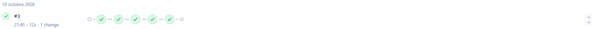
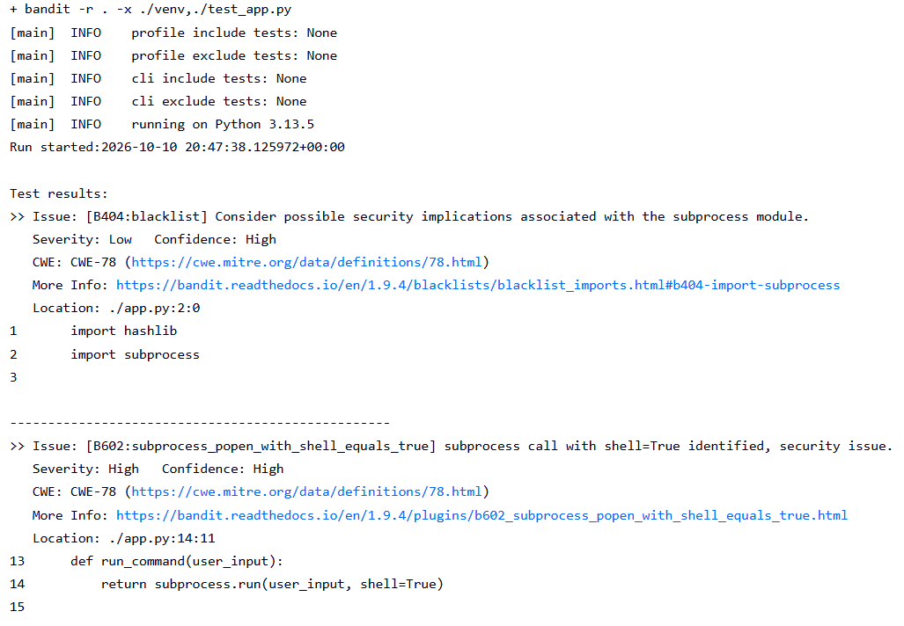
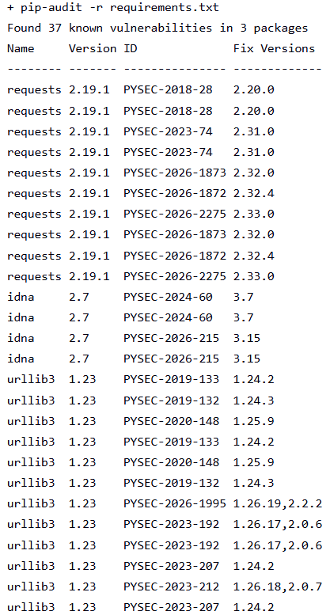
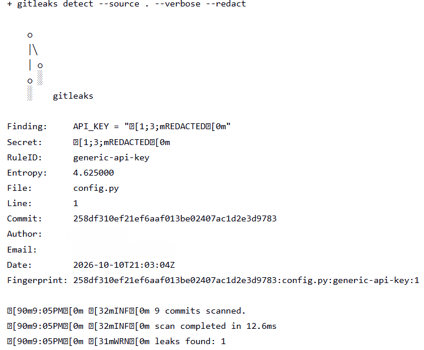

# DevSecOps CI Pipeline with Jenkins
 
A containerized **Jenkins CI pipeline** that automatically tests a Python app and scans it for security problems on every build. The build **fails automatically** if a secret, an insecure code pattern, or a vulnerable dependency is detected.
 

 
## Why this project
 
In classic DevOps, security checks often happen late. This project applies the **"shift left"** idea of DevSecOps: security scans run inside the CI pipeline, on every change, before anything gets deployed.
 
## Pipeline flow
 
```
GitHub repo ──> Jenkins ──> Checkout ──> Install ──> Tests ──> Gitleaks ──> Bandit ──> pip-audit ──> PASS / FAIL
```
 
| Stage | Tool | What it does |
|---|---|---|
| Checkout | Git | Pulls the code from GitHub |
| Install dependencies | pip + venv | Creates an isolated Python environment |
| Run tests | pytest | Runs the unit tests |
| Secrets scan | **Gitleaks** | Detects secrets committed in the code or Git history |
| SAST | **Bandit** | Detects insecure Python code patterns |
| Dependency scan | **pip-audit** | Flags libraries with known vulnerabilities (CVEs) |
 
Each security tool exits with an error when it finds something, which fails the stage and stops the pipeline.
 
## Tech stack
 
- **Jenkins** (LTS, JDK 21), running in **Docker** via Docker Compose
- **Pipeline as code** (`Jenkinsfile`)
- **Python 3**, pytest
- **Gitleaks**, **Bandit**, **pip-audit**
## Repository structure
 
```
.
├── app.py                  # Small demo application
├── test_app.py             # Unit tests
├── requirements.txt        # App dependencies
├── Jenkinsfile             # Pipeline definition
├── Jenkins-setup/
│   ├── Dockerfile          # Custom Jenkins image (adds Python, Git, Gitleaks)
│   └── docker-compose.yml  # Runs Jenkins with a persistent volume
└── images/            # Screenshots
```
 
## How to run it
 
**Prerequisites:** Docker (Desktop or Engine) and Git.
 
1. Clone the repo and start Jenkins:
```bash
   git clone https://github.com/EzerAbed/devsecops-pipeline-demo.git
   cd devsecops-pipeline-demo/jenkins
   docker compose up -d --build
```
2. Get the initial admin password:
```bash
   docker compose logs jenkins
```
3. Open `http://localhost:8080`, unlock Jenkins, install the suggested plugins and create an admin user.
4. Create a new **Pipeline** job:
   - Definition: **Pipeline script from SCM**
   - SCM: **Git**, repository URL: this repo
   - Branch: `*/main`
   - Script path: `Jenkinsfile`
5. Click **Build Now**.
Jenkins data is stored in a Docker volume, so it survives container rebuilds.
 
## Security gates demo
 
To prove the gates work, each scanner was tested on a separate branch containing one deliberate problem. These branches are never merged into `main`.
 
### 1. Bandit blocks insecure code
Branch `demo-bandit` adds `eval()`, `subprocess` with `shell=True`, and an MD5 password hash. Bandit fails the build.
 

 
### 2. pip-audit blocks vulnerable dependencies
Branch `demo-vulnerable-dependency` pins an outdated version of `requests` with known CVEs. pip-audit fails the build.
 

 
### 3. Gitleaks blocks committed secrets
Branch `demo-secret` commits a **fake** API key. Gitleaks fails the build, with the value redacted in the output.
 

 
> Gitleaks scans the full Git history, so deleting a leaked secret in a later commit is not enough. A real leaked secret must be **rotated**.
 
## What I learned
 
- How CI works end to end: commit, automatic build, test, scan, pass or fail
- How a Jenkins controller, pipelines and the Jenkinsfile fit together
- Building a custom Docker image and using Docker Compose with a persistent volume
- Why every `sh` step runs in its own shell and needs the virtualenv activated again
- Applying least privilege (switching back from root in the Dockerfile) and shift-left security in practice
## Possible improvements
 
- Automatic builds on every push (Poll SCM or webhooks)
- Build a Docker image of the app and scan it with **Trivy**
- Add an **Ansible** deployment stage
- Publish scan reports as Jenkins build artifacts